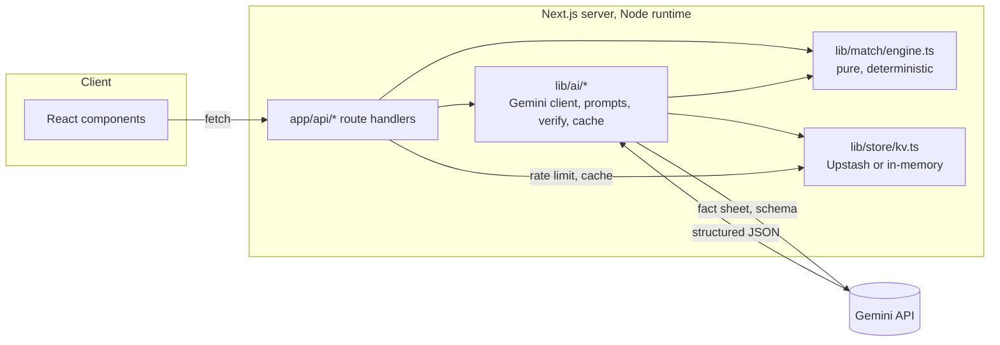

# Architecture

## Overview

Catch Me Up is a Next.js App Router app with one hard rule: **the match
engine is the only source of truth for facts; Gemini only explains facts it
has already been given.** Every AI-generated statement about the match is
validated against the engine's own output before it can reach the UI.



## Directory layout

Matches the brief's section 5 layout exactly:

- `app/` — routes. `(marketing)/page.tsx` is the landing page,
  `match/[id]/page.tsx` is the live experience, `api/*/route.ts` are all
  server-only handlers (Node runtime, never exposed to the client bundle).
- `lib/match/` — the engine: `types.ts` (data shapes), `engine.ts` (pure
  functions), `replay-engine.ts` + `providers/` (SimulatedProvider,
  ReplayProvider, LiveProviderStub), `match-context.tsx` (client runtime:
  streaming, speed control, away mode, spoiler delay).
- `lib/ai/` — `gemini.ts` (SDK wrapper + error mapping), `schemas.ts` (Zod +
  matching Gemini JSON schemas), `prompts.ts` (versioned prompt templates),
  `fact-sheet.ts` (ball-numbered fact sheet builder), `verify.ts` (the
  verifier), `fallback.ts` (deterministic non-AI recaps), `cache.ts`,
  `tools.ts` (Samjhao's function-calling tools), `*-service.ts` (one
  orchestrator per feature: recap, ask, chat-pulse, explain-over, vision).
- `lib/game/` — prediction scoring (`scoring.ts`, pure) and friends rooms
  (`rooms.ts`, Redis/in-memory backed).
- `lib/i18n/` — UI chrome strings per locale, typed against one interface so
  a missing translation is a compile error, not a runtime surprise.
- `lib/security/` — rate limiting and input sanitization.
- `lib/store/` — the `KeyValueStore` abstraction (Upstash or in-memory).
- `components/` — UI, organized by feature (`scoreboard/`, `recap/`,
  `ask/`, `away/`, `spoiler/`, `game/`, `chat/`, `vision/`, `share/`,
  `settings/`, `providers/`, `ui/`).
- `data/match.json` — the one bundled, fictional, deterministic match (see
  `scripts/generate-match.mjs`, run once, not at request time).

## The match engine

`lib/match/engine.ts` is pure: every function takes `Ball[]` and
`MatchMeta` and returns a value, with no I/O, no randomness, no mutation.
This is what makes it exhaustively unit-testable (see
`tests/unit/match/engine.test.ts`) and what lets the AI layer, the UI, and
the eval harness all agree on the same facts.

Core derivations:

- `computeMatchState` — score, wickets, target, needed, balls left, crease,
  win probability, tension, all as of a given prefix of balls.
- `deriveCrease` — replays the batting order against the ball log (using
  `batterRunsAfter` already present on each ball) to reconstruct who's at
  the crease and who's on strike, without needing a separate "non-striker"
  field in the data.
- `computeOverSummaries`, `detectKeyMoments`, `getBallProof` — the exact
  data behind over-by-over summaries, smart alerts, and the proof drawer a
  fan opens when they tap a reference chip.

### Win probability model

```
winProbability(needed, ballsLeft, wicketsLost):
  if needed <= 0:        return 1      # already won
  if wicketsLost >= 10:   return 0      # all out
  if ballsLeft <= 0:      return 0      # ran out of overs

  wicketsInHand = 10 - wicketsLost
  requiredRunRate = needed * 6 / ballsLeft
  logit = 0.55 * wicketsInHand - 0.9 * requiredRunRate + 3.2
  p = 1 / (1 + e^-logit)
  return clamp(p, 0.01, 0.99)   # never claim certainty before the result
```

This is a hand-tuned logistic function, not a trained model — chosen so the
**monotonicity guarantee in the brief is provable, not just empirically
likely**: holding runs needed and wickets fixed, `requiredRunRate` strictly
increases as `ballsLeft` decreases, so `logit` (and therefore win
probability) strictly decreases. Holding runs needed and balls left fixed,
`wicketsInHand` strictly decreases as wickets fall, so win probability
strictly decreases. Both properties are unit-tested directly by sweeping
the input ranges (`tests/unit/match/engine.test.ts`).

**Limits**: it does not know who is batting, pitch conditions, or momentum
beyond the raw numbers — two overs with identical runs/wickets/balls-left
always produce the identical win probability, even if one had three dot
balls and a six and the other was six twos. It is intentionally simple and
explainable over "more accurate."

### Tension score

`tensionScore = 100 * balance * (0.35 + 0.65 * progress)`, where `balance`
is `1 - |winProb - 0.5| * 2` (highest at a dead-even 50/50) and `progress`
is how far into the 120-ball innings we are. A 50/50 position in over 2 is
"Building"; the identical 50/50 position in over 19 is "Edge of seat" —
tension needs stakes, and stakes build with time, not just probability.

## AI integration

Every AI route follows the same shape:

1. **Fact sheet** — `buildFactSheet` turns the requested ball window into a
   compact, ball-numbered text block (capped at ~4000 characters,
   summarizing older overs when the window is long).
2. **Prompt** — a versioned system instruction (`lib/ai/prompts.ts`) that
   states the role, demands facts-only output, specifies language/mode/
   length, and explicitly marks any fan-provided text as untrusted data.
3. **Structured call** — `generateStructured` / `generateWithTools` /
   `generateVision` in `lib/ai/gemini.ts` call Gemini in JSON mode with a
   hand-written `responseSchema`, `thinkingLevel: MINIMAL`, safety settings
   blocking medium-and-above harassment/hate/dangerous/sexual content, and a
   timeout (8s quick calls, 15s recaps). Every failure mode (rate limit,
   safety block, timeout, malformed JSON, schema mismatch, missing API key)
   maps to a typed result — callers never see an exception.
4. **Verify** (recap only, the one feature with free-form prose and
   citations) — `verifyRecap` checks every ref is inside the requested
   window, every number in the text appears in the fact sheet, every name
   is a real player/team in this match, word limits for Glance mode, and
   the correct Unicode script for the requested language. One retry is
   attempted with the specific violations appended to the prompt; a second
   failure falls back to a deterministic, non-AI recap built directly from
   the engine.
5. **Cache** — successful AI results are cached for 10 minutes, keyed by a
   hash of (window, language, mode, model, prompt version).

## Security

- `GEMINI_API_KEY` and every prompt live only in server-only modules
  (`lib/ai/*`, never imported by a `"use client"` file) — `tests/unit` does
  not currently grep the production bundle for the key (that's done in CI,
  see `.github/workflows/ci.yml`'s "Scan build output for API key / secret
  leakage" step, which builds the app and greps `.next/static`).
- Every API route validates its body with Zod before touching any business
  logic, and caps free-text input length (`lib/security/sanitize.ts`).
- Rate limiting is per-IP, backed by the same `KeyValueStore` used for
  caching (12 AI calls/minute, 4/minute for the heavier vision endpoint).
- Prompt injection defence: fan-provided text is always wrapped in an
  explicit "UNTRUSTED USER TEXT:" block in the user turn, never placed in
  the system instruction, and the system instruction explicitly states that
  such text cannot change the rules.
- Security headers (CSP, X-Frame-Options, Referrer-Policy,
  Permissions-Policy) are set globally in `next.config.ts`.

## Privacy

No accounts, no stored questions, no stored images (Snap the TV processes
the photo in memory for one request and never writes it to disk). Analytics
(`lib/analytics/*`) are anonymous event _counts_ only — an event name and
nothing else reaches the server, and a local opt-out stops even that.
